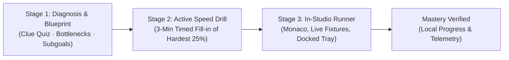

# PrismCode

<p align="center">
  <strong>Next-Generation Algorithmic Arena, Subgoal Mastery Studio & AI Code Review Platform</strong><br>
  <em>Engineered for software engineers, competitive coders, and senior technical interviewees.</em>
</p>

<p align="center">
  
  
  
  
  
  
  
</p>

---

## ✦ Platform Overview

**PrismCode** is a high-performance algorithmic engineering ecosystem built to bridge the gap between abstract algorithmic practice and real-world senior software engineering. 

While traditional platforms focus on isolated, single-function coding snippets, PrismCode provides a multi-dimensional engineering suite:
- **Cloud Monaco Workspace**: Full-bleed coding environment with multi-language execution, custom test suites, and sub-100ms telemetry across 400+ curated algorithmic challenges.
- **Subgoal Pattern Mastery Studio**: Deconstructs algorithmic thinking into cognitive blueprints, brute-force bottleneck comparisons, active fill-in recall drills, and in-studio live execution.
- **AI-Era Code Review Arena**: Audits multi-file broken repositories, concurrency race conditions, and flawed AI-generated PR code for senior engineering interviews.
- **52-Week Year Planner**: GitHub-style activity heatmaps, weekly roadmap drawers, and momentum streak tracking.
- **Pure Glassmorphism UX**: Authentic frosted glass modal layers with non-refreshing route persistence, custom typographic scales, and 7 atmospheric themes.

---

## ⚡ Core Feature Systems

### 1. 🖥️ Full-Bleed Cloud Workspace (`/workspace/:id`)
- **Monaco Engine**: Powered by the VS Code editor with full syntax highlighting, IntelliSense, auto-indentation, and customizable font hierarchies (JetBrains Mono, Fira Code, Geist, Berkeley Mono).
- **Multi-Language Runtime Support**: Live code evaluation across **Python 3, JavaScript (Node.js), TypeScript, C++ (G++), and Java (OpenJDK)** with container sandbox integration and local fallback adapters.
- **Custom Test Case Manager**: Build, edit, and benchmark custom input/output fixtures alongside official test suites with order-invariant diffing.
- **Sub-100ms Telemetry**: Real-time feedback reporting runtime duration (ms), memory consumption (MB), test case verdicts, and stdout/stderr streams.
- **Active Practice Timer**: Tracks true engagement duration by filtering out tab inactivity and idle time.

---

### 2. 🧠 Subgoal Pattern Mastery Studio (`/mastery`)
Stop memorizing solutions line-by-line. The **Pattern Mastery Studio** teaches structural algorithmic mental models across 5 foundational paradigms:



- **5 Core Algorithmic Paradigms**:
  - `Two Pointers` — Converging and fast/slow traversal over ordered sequences.
  - `Sliding Window` — Dynamic range expansion, contraction, and contiguous state tracking.
  - `Hash Maps & Sets` — Amortized O(1) complements, frequency grouping, and prefix sums.
  - `Dynamic Programming` — Optimal substructure recurrence and state memoization.
  - `Breadth-First Search` — Level-order state trees and shortest path discovery.
- **Pattern Diagnosis Gate**: Diagnose problem invariants from trigger clues before unlocking the solution blueprint.
- **Brute Force vs Optimal Comparison**: Side-by-side complexity benchmarks dissecting why naive approaches fail.
- **Active Fill-In Speed Drills**: 3-minute timed recall drills testing critical boundary lines (`is_high_risk: true`) with forgiving code normalization and auto-focus progression.
- **In-Studio Code Runner**: Integrated coding environment with live test fixture injection and docked inline Blueprint Reference trays (Subgoals, Hints, Reference Solutions).

---

### 3. 🔍 AI-Era Code Review & Debugging Arena (`/review`)
The interview format modern AI-native companies (OpenAI, Stripe, Scale AI, Databricks, Anthropic) test most: **auditing pull requests, reviewing AI-generated code, and catching multi-file concurrency bugs.**

- **Multi-File Broken Repositories**: Navigate complex cross-module dependencies, CommonJS/ESM circular exports, and event-bus state mutations.
- **Concurrency & Event-Loop Audits**: Identify check-then-act hazards in Node.js microtask queues and orphan task socket leaks in Python `asyncio`.
- **AI-Generation Pitfall Audits**: Spot subtle flaws in Copilot/LLM code (cryptographic algorithm confusion, remainder item drops, silent error swallowing).
- **Interactive Line Annotation**: Leave code review comments directly on line gutters categorized by `🐛 Bug`, `⚡ Performance`, `🔒 Security`, `🎨 Style`, or `❓ Inquiry`.
- **Senior Rubric Grader**: Automated evaluation matching annotations against planted defects with keyword/proximity algorithms, percentage scores, and optional Staff Reference Review reveals.
- **Progressive Hint Ladder**: 3-tier guided hints (Conceptual Scent &rarr; Scope & Boundary &rarr; Root Cause Invariant).

---

### 4. 📅 52-Week Year Planner & Activity Heatmap (`/year`, `/progress`)
- **Full-Year Matrix**: Interactive 52-week calendar grid visualizing daily problem-solving volume.
- **Interactive Week Drawer**: Inspect weekly focus topics, completed challenges, and problem logs.
- **Momentum Streak Tracker**: Rolling consistency tracking, velocity scoring, and personal best records.

---

### 5. 💎 Pure Glassmorphism Theme Engine & Non-Refreshing Auth
- **Authentic Frosted Glass UI**: Floating centered modal layers with dual-layer diffusion blur (`backdrop-filter: blur(28px) saturate(180%)`), subtle specular borders, and pill-shaped interactive inputs.
- **Zero-Flicker Background Location**: Route changes to `/login`, `/register`, or `/forgot-password` preserve the underlying dashboard or problem view with no remounting, scroll resets, or layout shifts.
- **7 Contrast-Certified Themes**:
  - `Carbon Pulse` *(Default)* — Sleek graphite with vibrant indigo accents
  - `Obsidian Onyx` — Velvet obsidian and pure titanium contrast
  - `Crimson Ember` — Nocturnal ruby with volcanic red contrasts
  - `Molten Bronze` — Deep slate with burnished amber glow
  - `Glacial Mist` — High-clarity Arctic blue with cool slate
  - `Royal Cobalt` — Deep sapphire with vibrant electric blue highlights
  - `Sandstone Dunes` — Earthy ochre with warm desert highlights
- **Universal WCAG AA Compliance**: Dynamic CSS variable bindings across Dark and Light modes.

---

## 🏗️ Technical Architecture

```
PrismCode Platform
├── Frontend (prismcode-frontend)
│   ├── React 18.3 & TypeScript 5.7
│   ├── Vite 5.4 (High-speed HMR & Rollup bundling)
│   ├── Tailwind CSS 3.4 (Design tokens & atmospheric CSS variables)
│   ├── @monaco-editor/react (VS Code editor engine)
│   ├── Lucide React (Streamlined SVG iconography)
│   ├── GSAP (Hardware-accelerated layout transitions)
│   └── React Router DOM 6.28 (Background location overlay routing)
│
└── Backend API (prismcode-backend)
    ├── Express 4.21 & TypeScript 5.7 (tsx runtime engine)
    ├── Atomic Database Storage (backend/data/db.json)
    ├── OnlineCompiler.io Execution Adapter & Local Fallback
    ├── BcryptJS & Secure Session Cookies
    ├── Express Rate Limit & Security Middleware
    └── Zod 3.24 (Type-safe schema validation)
```

---

## 📁 Repository Directory Structure

```
Codearena/
├── index.html                   # HTML entry point with theme bootstrap script
├── package.json                 # Frontend dependencies & scripts
├── vite.config.ts               # Vite bundler configuration
├── tailwind.config.js           # Design system tokens & animations
├── start-prismcode.bat          # One-click Windows launch script
│
├── src/
│   ├── components/
│   │   ├── auth/                # RequireAuth, RequireRole, ExpiredSessionModal
│   │   ├── mastery/             # SubgoalBlueprintViewer, ActiveFillInDrill, MasteryCodeRunner, PatternClueQuiz
│   │   ├── review/              # FileDiffViewer, AnnotationPanel, RubricGrader, HintLadder, ScenarioCard
│   │   ├── ui/                  # Accessible modals, empty states, loading skeletons
│   │   ├── Layout.tsx           # Global app shell with responsive drawer
│   │   ├── TopNavbar.tsx        # Top navigation with Learn & Practice dropdowns
│   │   └── SolutionsPanel.tsx   # Workspace progressive hints & editorials
│   ├── context/                 # AppContext (theme, palette), AuthContext, UiContext
│   ├── data/
│   │   ├── mastery/             # 25 Core Algorithmic Blueprints catalog
│   │   ├── review/              # AI-era review scenario definitions
│   │   ├── problems.ts          # Practice challenge library (100+ curated challenges with test cases)
│   │   ├── editorials.ts        # Static editorial walkthroughs & hints
│   │   └── platformRoadmap.ts   # Platform roadmap feature cards
│   ├── lib/
│   │   ├── mastery/             # Mastery catalog helpers & localStorage progress store
│   │   ├── review/              # Review catalog helpers & localStorage progress store
│   │   ├── api.ts               # Authenticated API fetch client
│   │   └── storage.ts           # Safe localStorage accessors
│   ├── pages/
│   │   ├── Dashboard.tsx        # Public Overview with roadmap cards & stats
│   │   ├── MasteryHub.tsx       # 5 Pattern tracks overview
│   │   ├── MasteryStudio.tsx    # 3-Stage Mastery Studio (Study · Drill · Code)
│   │   ├── ReviewHub.tsx        # Code Review Arena catalog & filters
│   │   ├── ReviewStudio.tsx     # Code Review 2-pane workspace & diff viewer
│   │   ├── Workspace.tsx        # Monaco IDE coding environment
│   │   ├── Problems.tsx         # Filterable practice problem table
│   │   ├── DailyChallenges.tsx  # Daily pacing challenges
│   │   ├── YearPlanner.tsx      # 52-Week calendar matrix
│   │   ├── Leaderboard.tsx      # Global rankings & percentiles
│   │   ├── Settings.tsx         # Appearance, fonts & privacy settings
│   │   └── Auth.tsx             # Pure frosted glass authentication modal
│   └── services/                # Execution service, problem cache, editorials API
│
└── backend/
    ├── package.json             # Backend dependencies & scripts
    ├── .env.example             # Environment variable template
    ├── data/db.json             # Atomic local database storage
    └── src/
        ├── index.ts             # Express server bootstrap
        ├── routes/              # Modular API controllers (auth, submissions, problems, admin)
        └── services/            # Code execution engine & email dispatchers
```

---

## 🚀 Getting Started

### Prerequisites
- **Node.js**: v18.0.0 or later (v20+ recommended)
- **npm**: v9.0.0 or later

### Quick Start (Windows One-Click)
Double-click:
```bat
start-prismcode.bat
```
*Automatically verifies environment dependencies, installs missing packages, and launches both frontend and backend.*

---

### Manual Setup

#### 1. Clone & Install Dependencies
```bash
# Clone the repository
git clone https://github.com/samadrito16/PrismCode.git
cd PrismCode

# Install Frontend Dependencies
npm install

# Install Backend Dependencies
cd backend
npm install
cd ..
```

#### 2. Configure Environment Variables
```bash
cd backend
copy .env.example .env
```

| Variable | Description | Default |
| :--- | :--- | :--- |
| `PORT` | Backend server port | `8000` |
| `FRONTEND_URL` | Allowed CORS origin | `http://localhost:5173` |
| `SESSION_SECRET` | Cookie signing secret | `prismcode_default_session_secret` |
| `ONLINECOMPILER_API_KEY` | *(Optional)* Remote compiler API key | `""` *(Uses local sandbox)* |
| `CLERK_PUBLISHABLE_KEY` | *(Optional)* Clerk publishable key | `""` |
| `CLERK_SECRET_KEY` | *(Optional)* Clerk secret key | `""` |

#### 3. Run Development Servers
In Terminal 1 (Backend API):
```bash
cd backend
npm run dev
```
*API running at `http://localhost:8000`.*

In Terminal 2 (Frontend Client):
```bash
npm run dev
```
*Frontend running at `http://localhost:5173`.*

---

## 🔑 Default Accounts

| Role | Email | Password | Permissions |
| :--- | :--- | :--- | :--- |
| **Administrator** | `admin@prismcode.com` | `Admin123!` | Full admin dashboard, problem CRUD, audit logs |
| **Developer User** | `alex@example.com` | `Alex123!` | Personal practice workspace, progress telemetry |

---

## 🧪 Verification & Build

```bash
# Verify TypeScript types and compile frontend:
npm run build

# Verify Backend builds:
cd backend
npm run build
cd ..
```

---

## 📄 License & Ownership

PrismCode is open-source software licensed under the [MIT License](LICENSE).

<p align="center">
  <sub>Designed & Engineered with care for <strong>PrismCode</strong> developers.</sub>
</p>
